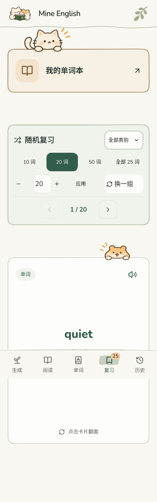
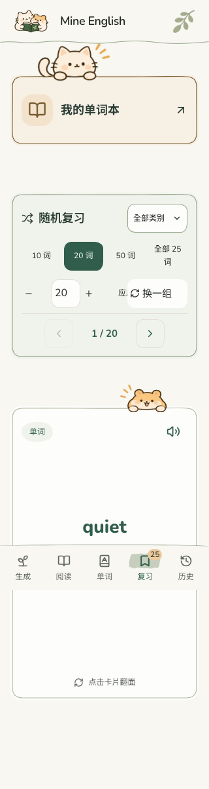
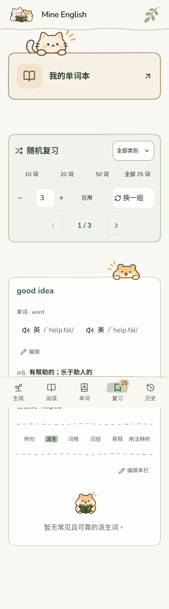
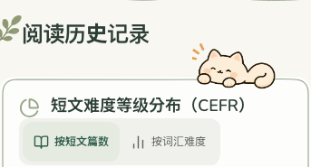

# 2026-11-10 响应式与词汇细节调整

本轮合并用户连续标注：手机随机复习改为四排紧凑布局，删除入口及当前模式说明；所有词汇小型空状态改为上图下文居中；词形按名词、动词单数及其他常用变化固定排序；预览保存提示变小并斜体。

同时完成此前待验收项：历史统计卡上移、手机/平板角色尺寸微调、删除历史页面三处说明；翻卡背面保留仓鼠；底部导航图标使用不规则笔刷高亮；安装/启动图标替换为正式猫鼠共读素材。

## 文件

- `src/handDrawn.css`：响应式排布、居中状态、提示样式、历史角色及图标笔刷。
- `src/views/PracticeHubView.tsx`、`ReviewView.tsx`、`ReadingHistoryView.tsx`、`src/components/ReadingLevelPieChart.tsx`：仅移除指定文案。
- `src/components/PracticeVocabularyCard.tsx`、`InstalledAppBottomNav.tsx`：翻卡仓鼠、图标高亮。
- `src/utils/vocabularyDetails.ts`、`src/components/VocabularyDetailsPanel.tsx`：只对展示副本排序，不改存储内容或手动编辑。
- `public/icons/` 五张导出图、`public/site-icon.png`、两个 manifest、`index.html`、`AppInstallPrompt.tsx`、`scripts/generate-app-icons.py`：启动及安装图标，原始角色图片未修改。
- 对应现有测试更新：historyVocabulary、motion、practiceHub、readingLevelDistribution、vocabularyScope、wordFormation；补充固定排序/原数据不变测试。
- `DESIGN.md` 与本报告、截图记录。

## 检查

- TypeScript、生产构建通过；现有测试 278 项全部通过。构建仍有原有大分包提醒。
- 隔离浏览器使用合成旧词条/资料，不接触用户浏览器数据库，不调用真实 AI。
- 320、375、820、1440px：分类、紧贴触发器的下拉菜单、自定义数量、换一组、上一张/下一张、无横向溢出。
- 手机面板约 253px 高；控件保留 44px 点击高度，原字体和色值未改。
- 正反面仓鼠、减少动态效果模式正常；小型空状态图片居中且文字在下方。
- 历史位置另检查 768、1023px；标题无重叠、仓鼠书底锚点保持。
- Manifest 图标尺寸/文件像素与本地一致，Android 浏览器选择有效 manifest，maskable 图标主体位于安全区域内。
- 真实 Android 系统启动画面无法在桌面浏览器复现；已安装应用的图标刷新由系统/Chrome 管理，可能提示确认图标更新。

## 实际页面截图

