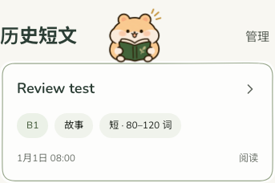
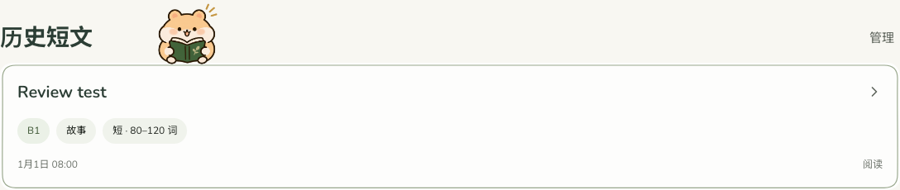
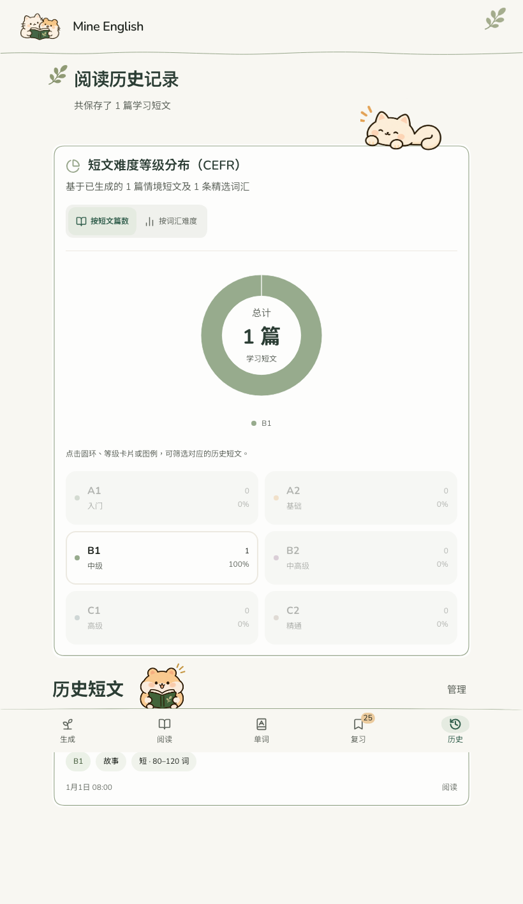
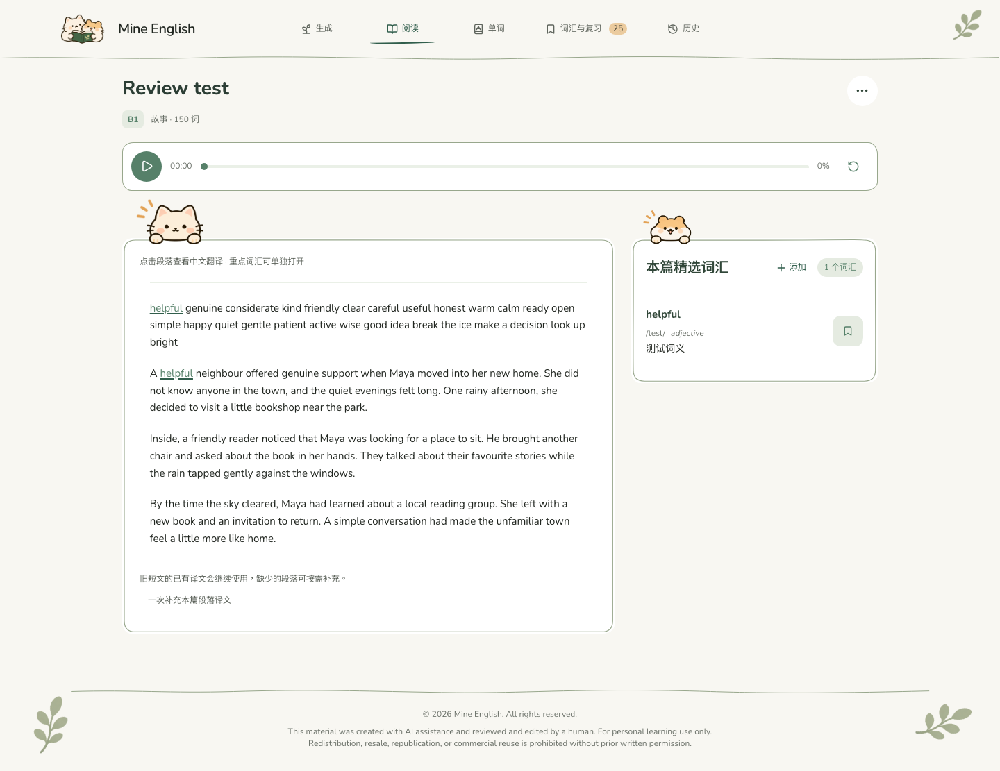
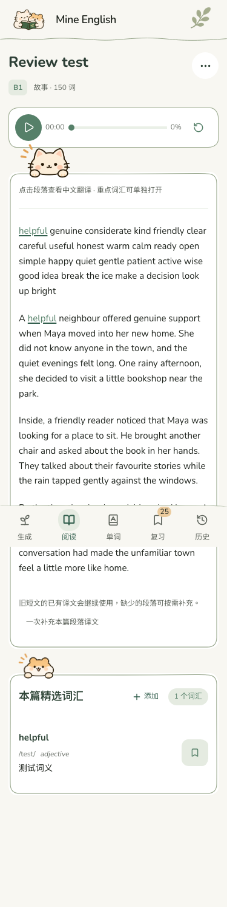
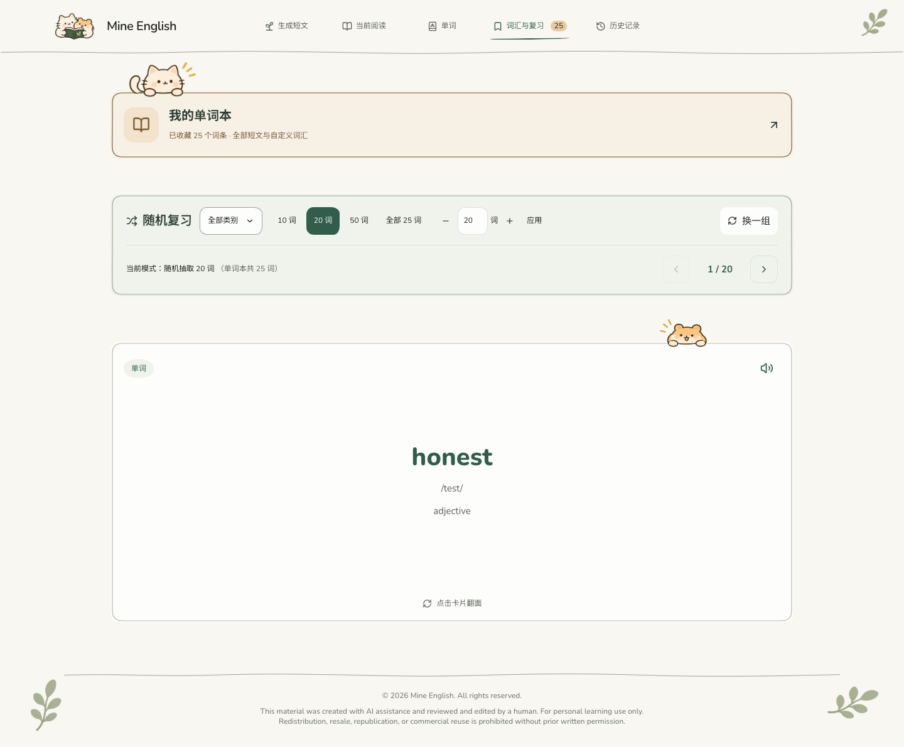
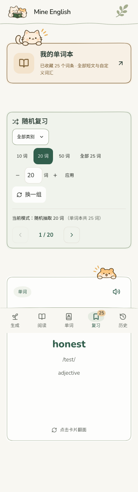
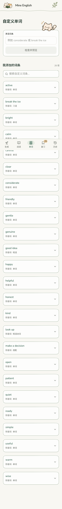
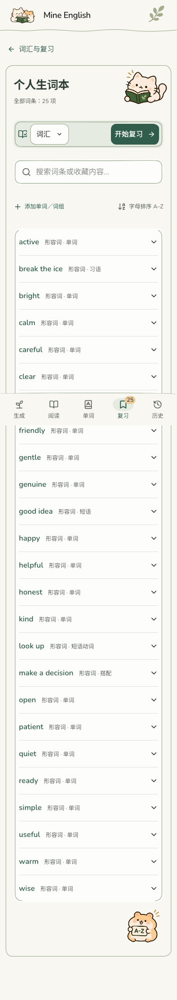
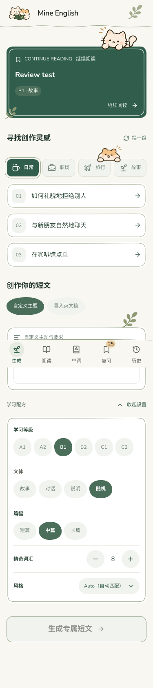

# 页面专用素材与角色定位修正

## 已完成

- 检查新包全部 17 张 PNG 和使用说明；原有 12 张像素与上一包一致，新增 5 张按用途登记到公共 Mascot 组件。
- 历史捧书仓鼠改用 `hamster-reading.png`，以第一张历史卡片作为定位基准，书本底部贴卡片上边线，位于标题右侧。去掉默认排序说明；有筛选时保留筛选反馈，并隐藏该装饰避免碰到等级标签。没有历史卡片时不显示悬空仓鼠。
- 使用底部导航的手机、平板及紧凑模式隐藏版权页脚；普通桌面模式保留。
- 保留原始比例、透明背景和主体三条手绘短线。不重新绘制、不翻转、不修改图片像素。阅读仓鼠图片右侧透明留白内有孤立残余笔触，仅以 CSS 遮罩该留白，主体和三条短线完整显示。
- 其他功能、配色、字体、加载动画、数据与接口流程保持不变。

## 素材对应

| 新素材 | 页面位置 | 修改组件 |
|---|---|---|
| cat-peeking-vocabulary.png | 复习页「我的单词本」卡片左上沿，左卷尾 | PracticeHubView |
| hamster-peeking-flashcard.png | 复习词卡上沿靠右 | PracticeVocabularyCard |
| cat-peeking-reading-page.png | 阅读文章卡片左上沿，无尾巴 | ReadingView |
| hamster-peeking-reading-page.png | 阅读精选词汇卡片左上沿 | ReadingView |
| cat-peeking-history-page.png | 历史统计面板右上沿，闭眼微笑 | ReadingLevelPieChart |

原有首页/自定义猫猫、灵感仓鼠、看书空状态、生词本看书猫和 A–Z 仓鼠不重复替换为其他近似姿势。

其他文件：`src/components/LearningArt.tsx`（资源注册与原始尺寸）、`src/views/ReadingHistoryView.tsx`（卡片定位）、`src/handDrawn.css`（尺寸、边缘定位和页脚可见性）、`public/illustrations/mascots/manifest.json`、`DESIGN.md`、`.impeccable/design.json`。

## 检查结果

- Chromium 独立浏览器、合成旧资料，检查首页、阅读、自定义、复习、生词本、历史统计及复习任务，共 4 种宽度：320 / 375 / 820 / 1440px。
- 每种宽度第一张历史卡片与仓鼠可见底部距离约 2px（包含边框），不再依赖标题负偏移。
- 无横向溢出；对应页面正确使用 5 张专用素材；手机和平板页脚隐藏、桌面页脚保留。
- TypeScript、生产构建通过，277 项现有测试全部通过；仅存在原有的构建体积提示。
- 未修改服务端、AI 规则、数据库、收藏/复习存储和加载动画。
- 截图为测试资料；未验证实体设备和 Safari，响应式证据来自 Chromium 视口检查。

## 实际截图

