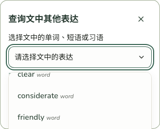
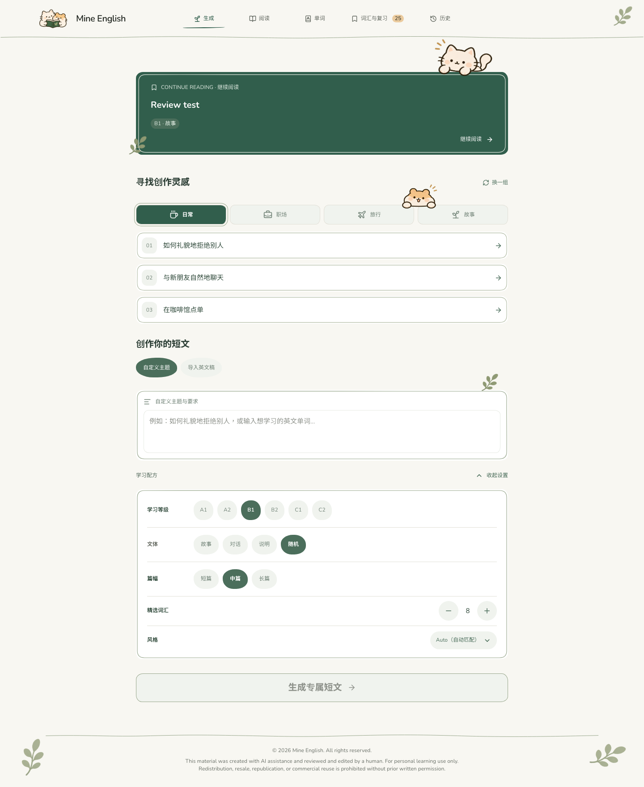
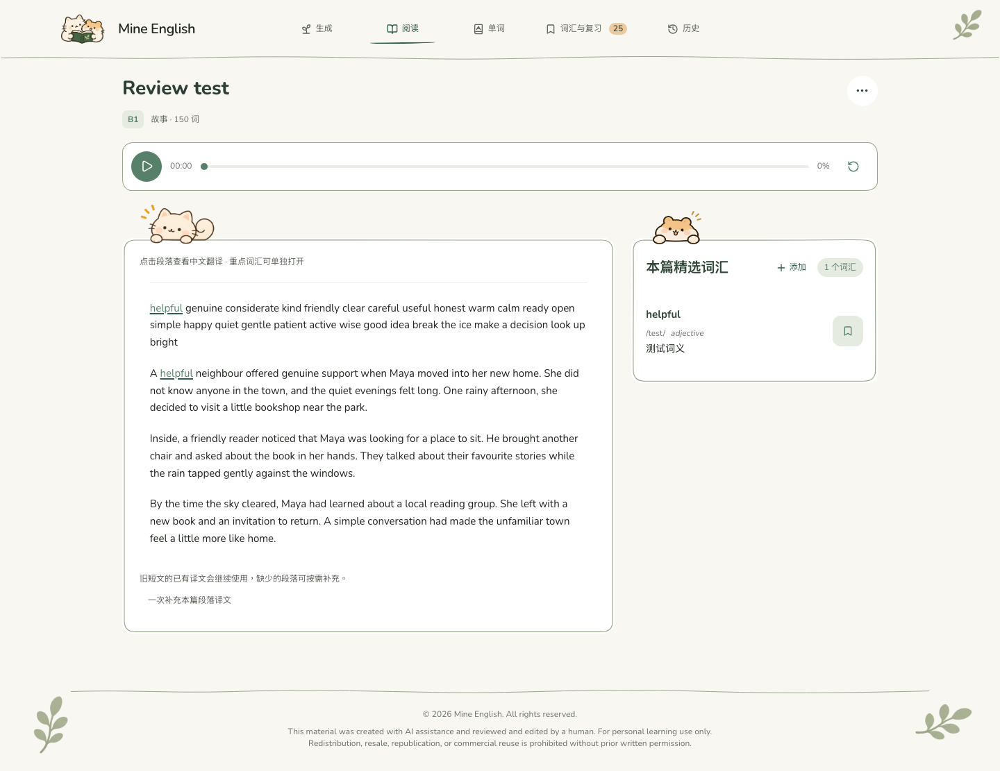
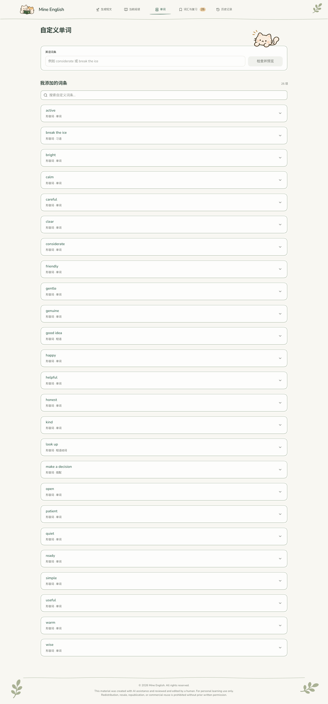
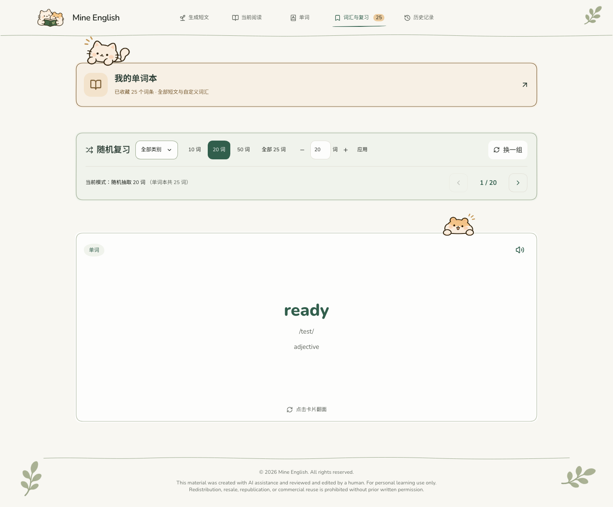
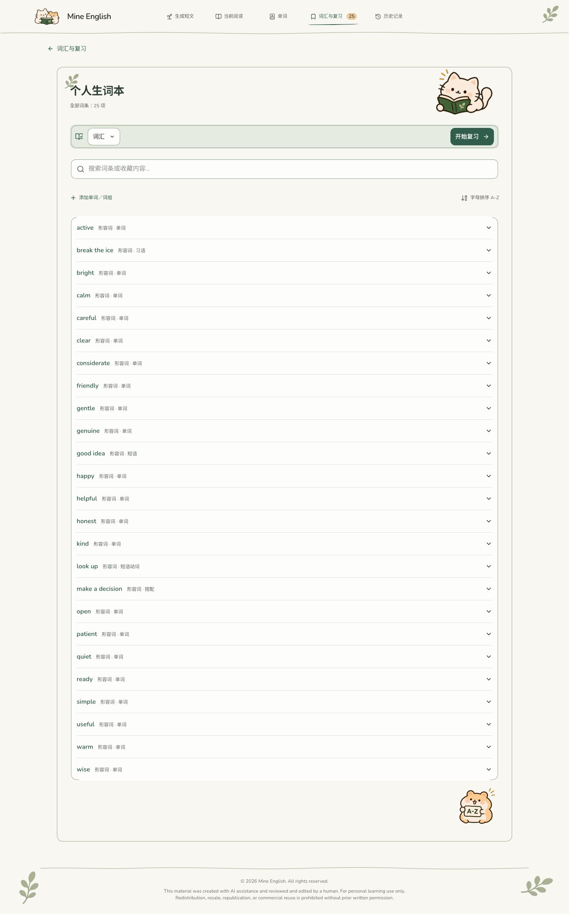
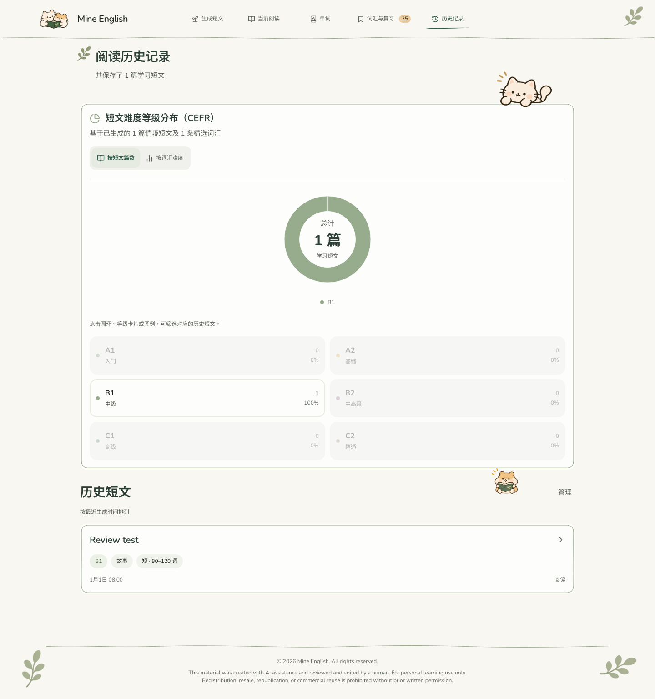
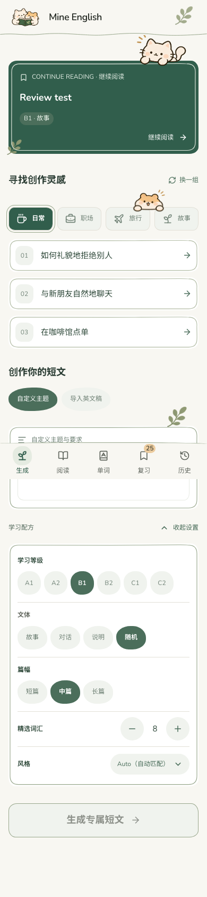
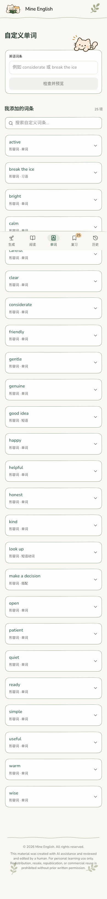
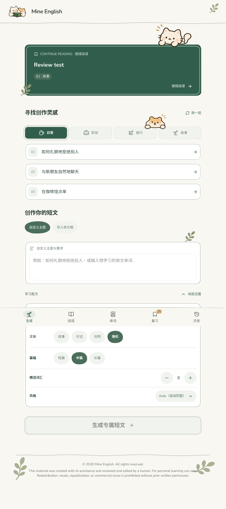

# 正式角色素材替换与手机查询菜单修复

## 修改范围

静态角色由旧图集改为用户提供的 12 张独立透明 PNG。原始 RGBA 像素逐一校验一致，文件仅增加来源元数据；没有重绘、裁切、变色或额外画强调线。旧图集仅继续供植物装饰使用。五组加载动画资源及调用行为不变。

公共组件 `src/components/LearningArt.tsx` 统一登记文件、原始尺寸及卡片边缘定位基准，使用 contain 保持比例；装饰图片加载失败仅隐藏自身，不影响页面功能。样式集中在 `src/handDrawn.css`，没有改动色系、字体、数据结构或 AI 接口。

## 实际修改文件

- `src/components/LearningArt.tsx`：正式素材注册、独立图片与失败处理。
- `src/handDrawn.css`：角色比例、尺寸、定位和手机查询菜单占位修复。
- `src/components/ExpressionSelect.tsx`：明确控件类名，键盘仅滚动选项菜单。
- `src/components/HistoryVocabularyTasks.tsx`、`src/components/VocabularyDetailsPanel.tsx`：使用对应正式角色。
- `src/views/CustomWordsView.tsx`、`src/views/ReadingView.tsx`、`src/views/ReadingHistoryView.tsx`、`src/views/WordbookView.tsx`：按参考图选用独立角色。
- `src/utils/polish.test.ts`：保留键盘导航限制并检查禁止整页 scrollIntoView。
- `DESIGN.md`、`PRODUCT.md`、`.impeccable/design.json`：记录正式素材规范与本次修复。
- `public/illustrations/mascots/`：12 张 PNG 与来源及像素校验清单。
- `docs/screenshots/mascots/`：10 张实际浏览器截图。
- 本报告。

## 图片与页面

| 图片 | 使用位置 |
|---|---|
| cat-hamster-book-logo.png | 全站品牌 Logo、部分空状态 |
| cat-peeking.png | 首页继续阅读、自定义输入区、单词本入口、历史统计 |
| cat-peeking-alt.png | 阅读文章卡片边缘 |
| hamster-peeking.png | 创作灵感、阅读词汇区、复习卡片 |
| cat-reading.png | 个人生词本标题区 |
| hamster-reading.png | 自定义词条及词汇资料空状态 |
| hamster-reading-alt.png | 历史短文与词汇复习任务区域 |
| hamster-az.png | 非空个人生词本列表下方 |
| cat-thinking.png | 搜索无结果状态 |
| cat-sleeping.png | 已登记备用，不强制新增装饰 |
| cat-celebrating.png | 已登记备用，不新增完成流程 |
| hamster-reminder.png | 已登记备用，不新增提示流程 |

全部文件位于 `public/illustrations/mascots/`，原始尺寸与像素散列记录在 `manifest.json`。

## 手机端空白问题

`ExpressionSelect` 原先 `basis-64` 在横排控件中表示 16rem 宽度，手机改为纵排后变成 16rem 高度，导致大块空白与选项远离按钮。手机端将 flex 改为 `0 0 auto`，高度随内容收缩，桌面及平板横排不变。键盘选项导航仅滚动菜单自身，选中后恢复焦点时禁止整页滚动。

## 验证

- TypeScript 检查、生产构建通过；277 项现有测试全部通过。
- 独立无痕浏览器使用合成资料，检查首页、阅读、自定义、复习、生词本、历史。
- 320 / 390 / 820 / 1440px 下查询控件高度 74px；菜单与按钮间距 8px；键盘 End 未引发整页滚动；页面没有横向溢出。
- 12 张正式资源原始 RGBA 像素一致，透明背景与内嵌强调线保留。
- 图片请求失败测试通过：仅隐藏角色，表单继续可用，无页面脚本错误。
- 合成旧资料的复习次数、下次复习时间与间隔检查保持不变。
- 服务端、AI 提示词、接口、数据库与加载动画文件均未修改。未操作用户浏览器资料。
- 构建仍有原有 chunk 大小提示，不影响构建成功。

## 实际截图

以下为独立测试数据截图，不是用户真实记录。

