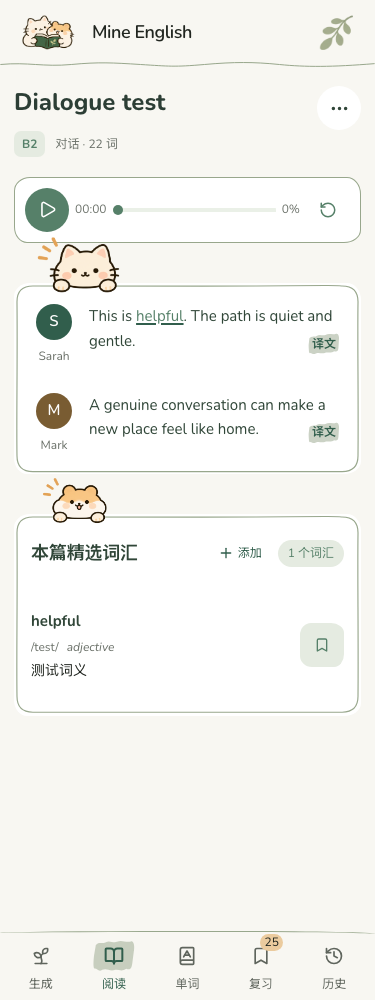
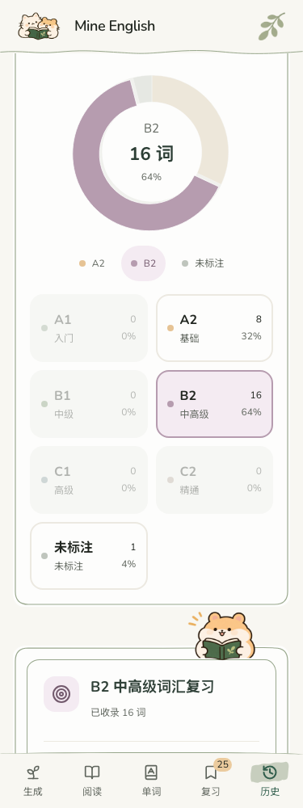
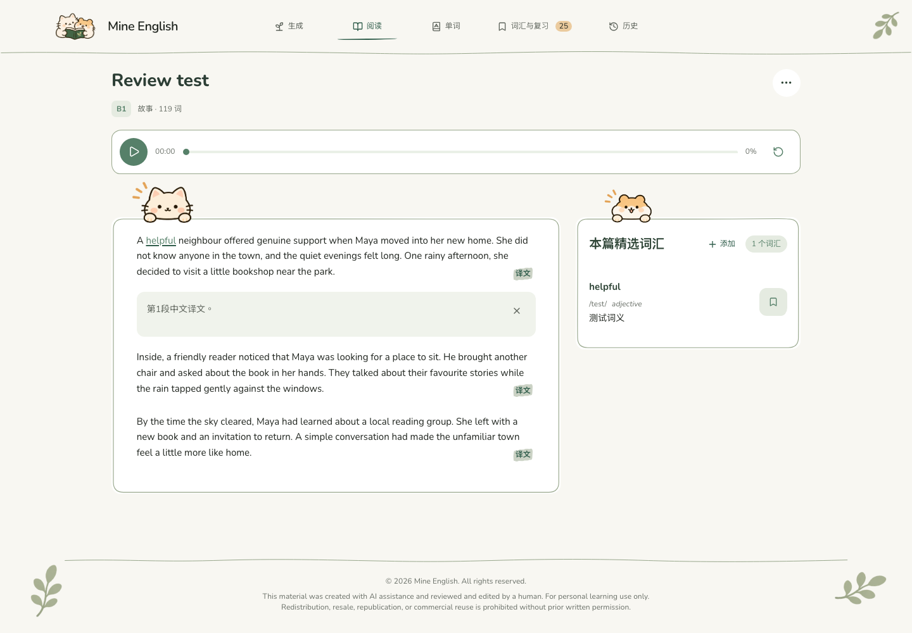
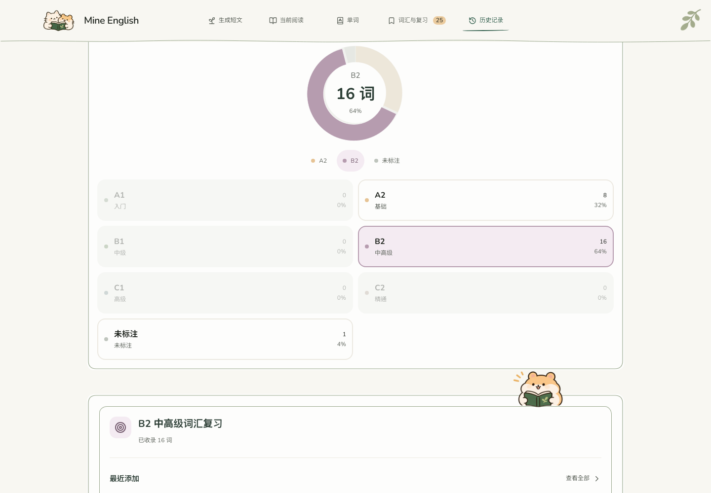

# 阅读与圆环交互调整 · 2026-11-10

## 最终行为

- 阅读卡片删除操作说明与内部顶部分隔线，保留外框和角色。
- 每段英文末尾靠右显示「译文」文字，使用既有浅绿色不规则笔刷背景。
- 鼠标悬停段落或译文按钮时，高亮整段英文；移开即消失。展开译文不导致持续高亮，触屏没有黏住的悬停效果。
- 点击段落或译文按钮切换同一段中文译文；键盘可操作。重点词汇保持独立点击，不触发翻译开关。
- 选中圆环扇区沿径向向外移动 5 个 SVG 单位，240ms 平滑过渡。切换等级时旧扇区归位，新扇区浮起。
- 中心等级、数量、百分比以及等级卡片和图例沿用同一个选择状态；取消选择恢复总计。
- 删除「当前筛选／清除筛选」提示条；再次点击已选扇区、卡片或图例仍可取消筛选。
- 未修改颜色、字体、数据结构、存储、AI 调用或翻译缓存逻辑。

## 修改文件

`src/views/ReadingView.tsx`、`src/components/ReadingLevelPieChart.tsx`、`src/utils/donutInteraction.ts`、`src/index.css`、`src/handDrawn.css`、`DESIGN.md`，及对应的 readingSegments、readingLevelDistribution、donutInteraction 现有测试。

## 验证

- TypeScript、生产构建通过；279 项测试通过，包含扇区径向方向与位移边界验证。
- 隔离浏览器用合成旧资料检查 1440、820、375、320px，无横向溢出；不读取用户浏览器资料、不调用真实 AI。
- 故事与对话逐段展开／收起、词汇弹窗与翻译事件隔离、键盘操作通过。
- 实际点击扇区、卡片及键盘选中后，验证中心真实计数、百分比、唯一选中状态、原扇区归位与新扇区浮起。
- 系统减少动态效果时无过渡动画；真实触屏模拟下译文可展开且无黏住的悬停底色。
- 桌面与手机截图如下，使用合成阅读资料与真实计算的分布。

