# 全站角色与叶子位置校准

依据用户原始九张 UI 示意图，以及最新版正式透明素材，复核了角色的可见轮廓、相邻标题间距、卡片贴边点和叶子的伸展方向。保留字体、配色、文案、学习业务与原始插画像素；不以更改页面文字大小来迁就插画。

## 各区域结果

| 区域 | 校准内容 |
|---|---|
| 全站 Logo | 保留共读图案原比例和现有位置，检查无遮挡 |
| 页眉叶子 | 朝左下伸展，匹配右上角示意方向 |
| 首页继续阅读 | 猫猫贴右上边线；左下叶子朝左上伸展 |
| 创作灵感 | 桌面仓鼠适度增大，爪子贴主题栏上沿；手机保留紧凑尺寸 |
| 自定义主题 / 导入英文稿 | 两种模式均显示右上向外伸展的叶子，不再切换后消失 |
| 阅读文章 / 精选词汇 | 专用猫猫和仓鼠按各自面板左上角校准偏移，保留爪子压线和发音/收藏操作区域 |
| 自定义词条 / 空状态 | 保留猫猫在输入框右上沿，检查思考/看书状态居中且无文字遮挡 |
| 复习入口 | 左卷尾猫猫增大，放在入口左上沿，保留右侧短线 |
| 复习词卡 | 仓鼠按示意适度增大并调整靠右位置，保留发音按钮空间和整卡翻面 |
| 个人生词本 | 看书猫猫增大并提高，书本仍在标题区；标题叶子避让文字；A–Z 仓鼠落在外框右下缘 |
| 历史统计 | 闭眼小猫按面板宽度缩放，爪子仍压住右上边线 |
| 历史短文 | 使用最新捧书仓鼠；横向随标题宽度定位，纵向以第一张卡片上沿为准 |
| 词汇复习任务 | 使用最新「抱书复习的小仓鼠.png」，左上短线保留；按书本/爪子底边定位右上沿，不碰上方统计区域 |
| 词汇六栏 | 不改导航与内容；复核空状态与角色显示 |
| 页脚 | 复核两侧叶子朝向；手机和平板底部导航模式继续隐藏版权页脚 |

## 历史标题校准依据

标题与仓鼠之间的可见间距参考原图约为标题宽度的 0.45 倍，新增 `ResizeObserver` 只测标题实际宽度。替代之前随整张卡片宽度变化的百分比偏移。四种视口实测间距比例为 0.455–0.460，书本底部距卡片外缘约 8px（含边框；按用户要求向下微调 6px），窄至 320px 时适度缩小角色以避让「管理」。

## 实际修改文件

- `src/handDrawn.css`：角色大小、贴边偏移、叶子方向及窄屏适配。
- `src/views/HomeView.tsx`：导入表单补齐同款叶子。
- `src/views/ReadingHistoryView.tsx`：只测量标题宽度，设置角色定位用 CSS 变量。
- `DESIGN.md`：记录校准后的定位规则。
- 本报告及 `docs/screenshots/reference-calibration/` 截图。

## 检查

- TypeScript、生产构建通过，277 项现有测试通过。
- 独立 Chromium 使用合成数据，1440 / 820 / 375 / 320px 全页面检查，无横向溢出。
- 额外检查导入/自定义切换、叶子方向、空搜索角色、整卡翻面与六栏详情；没有页面脚本错误。
- 静态资源、加载动画、接口、AI 提示词、数据库与收藏/复习记录未修改。
- 没有实体手机或 Safari 的实测证据；本轮响应式验证来自 Chromium。

## 当前实际截图

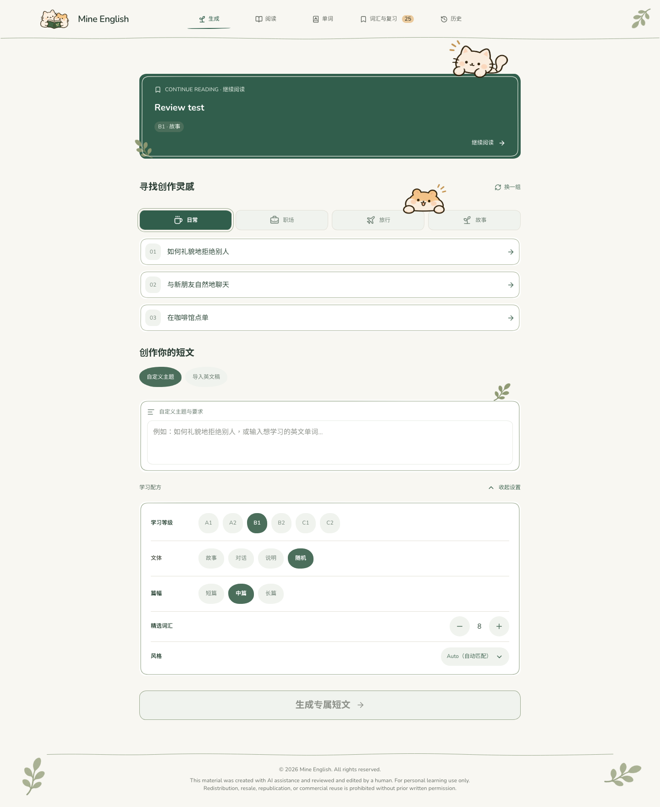

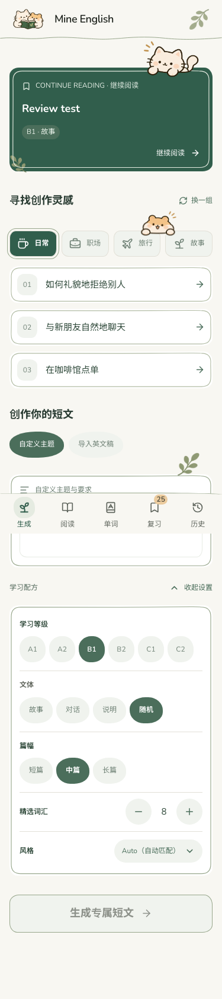

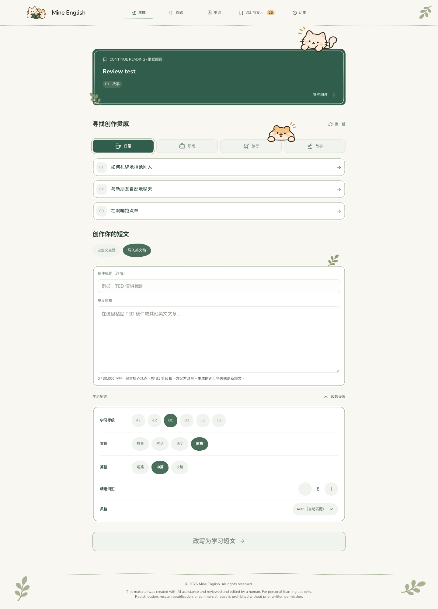

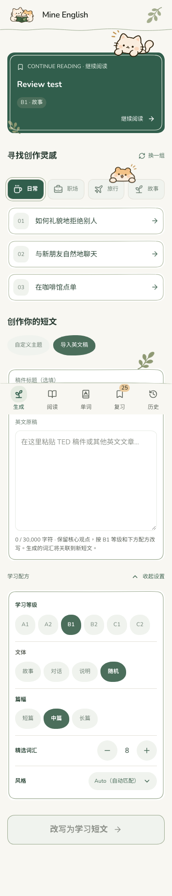

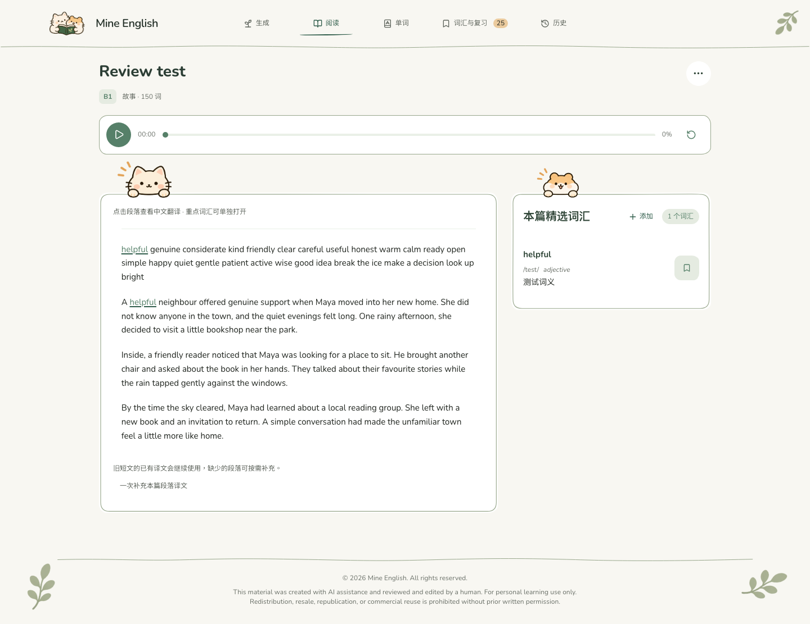

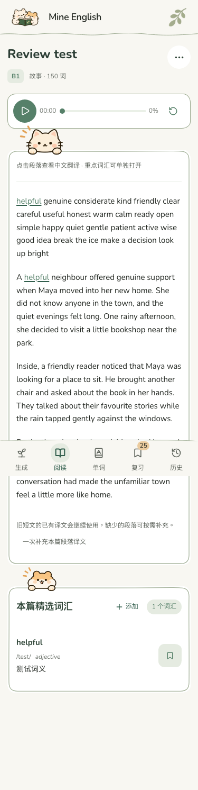

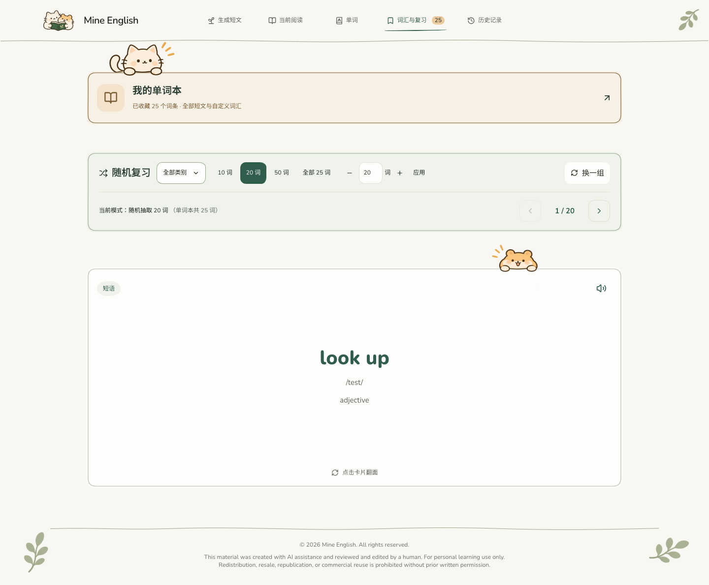

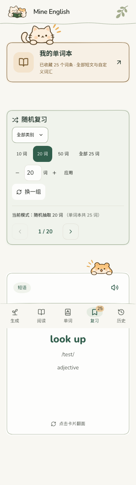

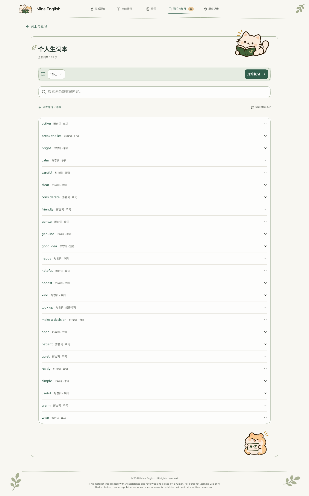

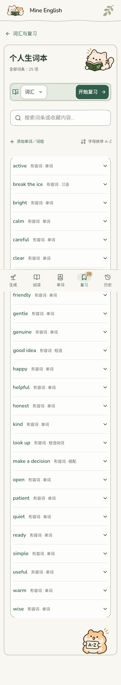

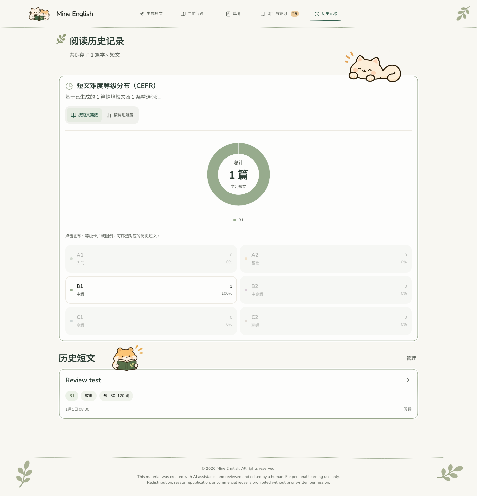

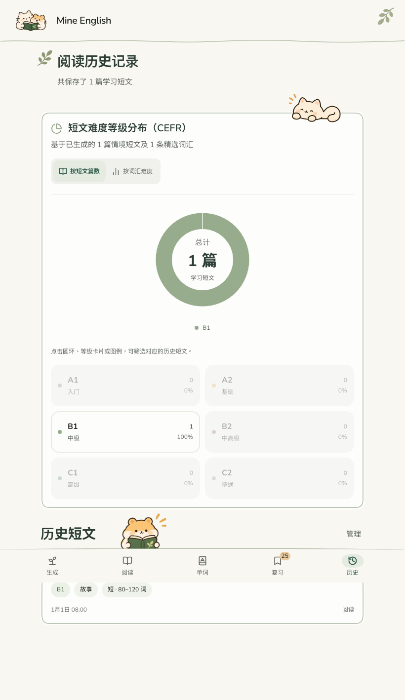

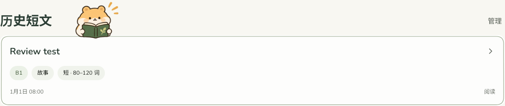

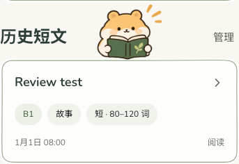

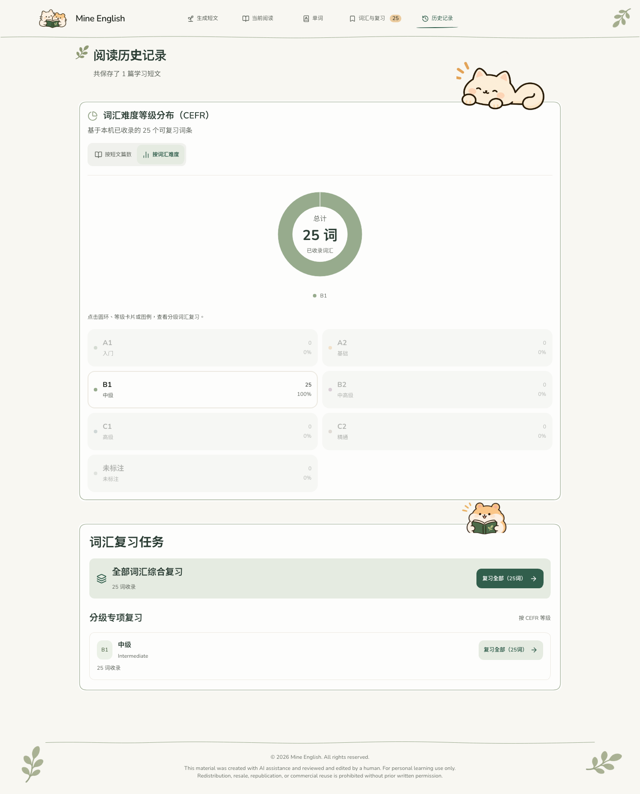

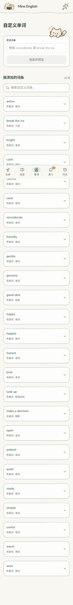

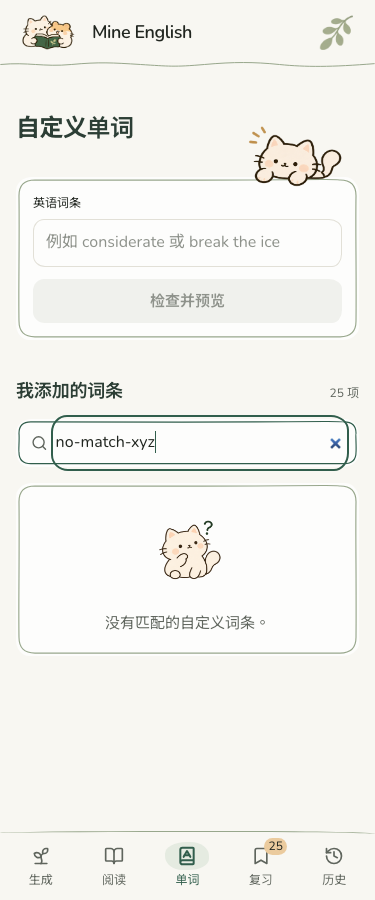

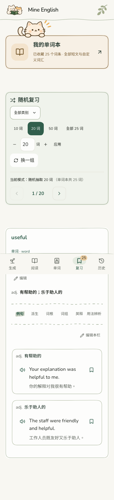

## 最终逐图复核与任务仓鼠

- 本次再次对照九张用户示意图：品牌、首页/手机首页、阅读、个人生词本、自定义词条、复习卡、六栏空状态、历史文章统计、历史词汇复习任务。
- 首页猫猫的爪子压入边线、统计闭眼猫猫的前爪、以及生词本看书猫的上下位置均重新校准；没有改变角色比例或镜像角色。输入模式中的叶子在两种模式保持一致。
- 最新 `抱书复习的小仓鼠.png` 原文件直接复制为 `public/illustrations/mascots/hamster-review-tasks.png`，1536×1024，登记为第 19 个正式资源。只在 `HistoryVocabularyTasks` 使用，保留左上三条原图手绘短线。
- 任务仓鼠按原图手部基准线 821/1024 定位，书本低于爪子基准线少许，形成卡片上沿前后的覆盖关系；桌面/平板宽 164px，手机宽 136px，不扩大模块或移动功能。
- 1440 / 820 / 375 / 320px 实测：角色最上部与上方统计卡片至少间隔 2.4px；书本压入任务面板约 26px（桌面/平板）或 17.5px（手机）。没有遮挡模块标题、复习入口或图表。
- 最终 TypeScript、生产构建及 277 项现有测试全部通过。所有 19 张资源 RGBA 校验一致，新图文件与用户原图逐字节相同。
- 本轮涉及 `src/components/HistoryVocabularyTasks.tsx`、`src/components/LearningArt.tsx`、`src/handDrawn.css`、资源 PNG/manifest、`DESIGN.md`、`.impeccable/design.json` 与本报告/截图。接口、存储、学习规则和其他页面功能不变。

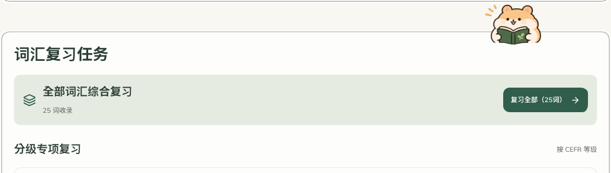

## 用户最后确认的微调

- 历史短文旁仓鼠：保持大小与横向间距，向下 6px。
- 历史统计猫猫：缩小约 15%，再向左 16px；爪子贴边高度不变。
- 1440 / 820 / 375 / 320px 下检查通过；管理操作正常，无页面脚本错误或横向溢出，生产构建通过。

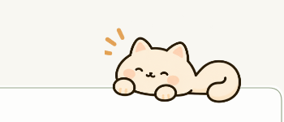

## 最新任务标题边界

按用户后续要求，将「词汇复习任务」标题移到框外，只有内容面板保留边框；仓鼠提高至内容卡片上沿，书本约压入 8px。分级详情和复习入口不变。[最新检查与截图](task-heading-adjustment.md)。
