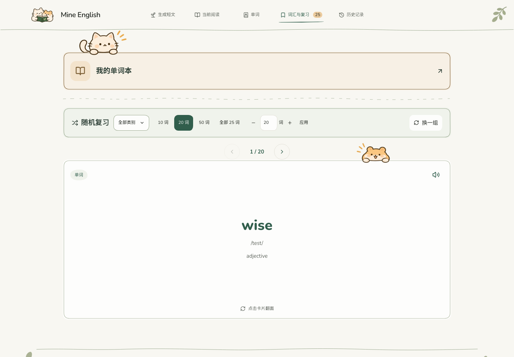

# 词汇与复习布局调整 · 2026-11-10

- 「我的单词本」和随机筛选继续分别使用原来的外层手绘框，未合并。
- 两模块之间加入浅绿色波形虚线，长短与间隔交错，使用原主题色。
- 翻页控件移出筛选框，放在筛选框与单词卡片之间。
- 仓鼠保持原尺寸（桌面/平板 208px、手机 160px），继续粘在卡片上沿，正反面均保留；整张卡片上移，使仓鼠大致与翻页控件同排。
- 手机翻页控件靠左避让，360–639px 再右移 12px；小平板适度偏左。按钮和仓鼠可见像素没有重叠。
- 手机数量控件收紧排列，为「换一组」预留单行宽度。320px 极窄屏空间不足时，按钮独立一排，保持原字号及 44px 触控尺寸。

修改：`LearningArt.tsx`（可复用虚线）、`PracticeHubView.tsx`（模块分隔）、`ReviewView.tsx`（外置翻页）、`handDrawn.css`、`DESIGN.md`。另修正 `vocabularyDetails.ts` 排序工具的返回类型推断，不改变排序行为或数据。

检查：TypeScript 与生产构建通过；278 项现有测试通过。隔离浏览器以合成旧数据检查 320、375、640、820、1023、1440px 的双框、虚线、外置翻页、上下张、翻卡、原尺寸仓鼠、横向溢出和可见像素遮挡。未调用真实 AI、未操作用户数据。

